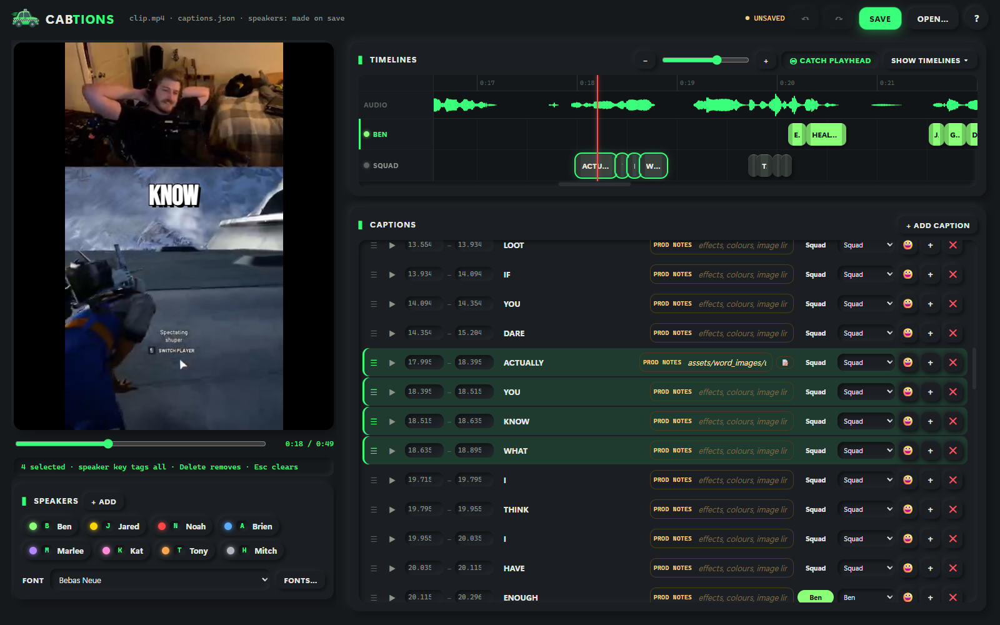
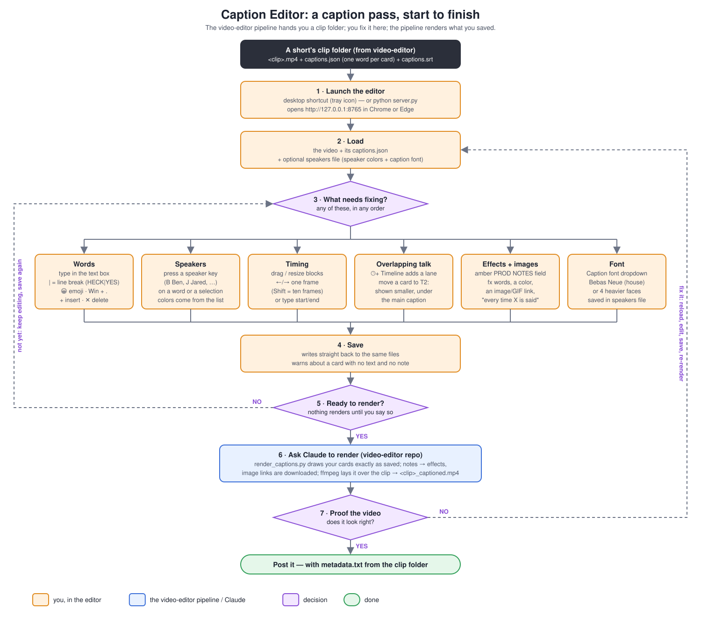
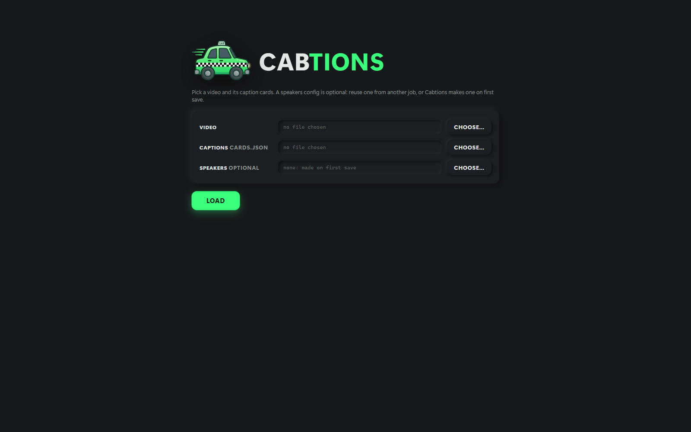
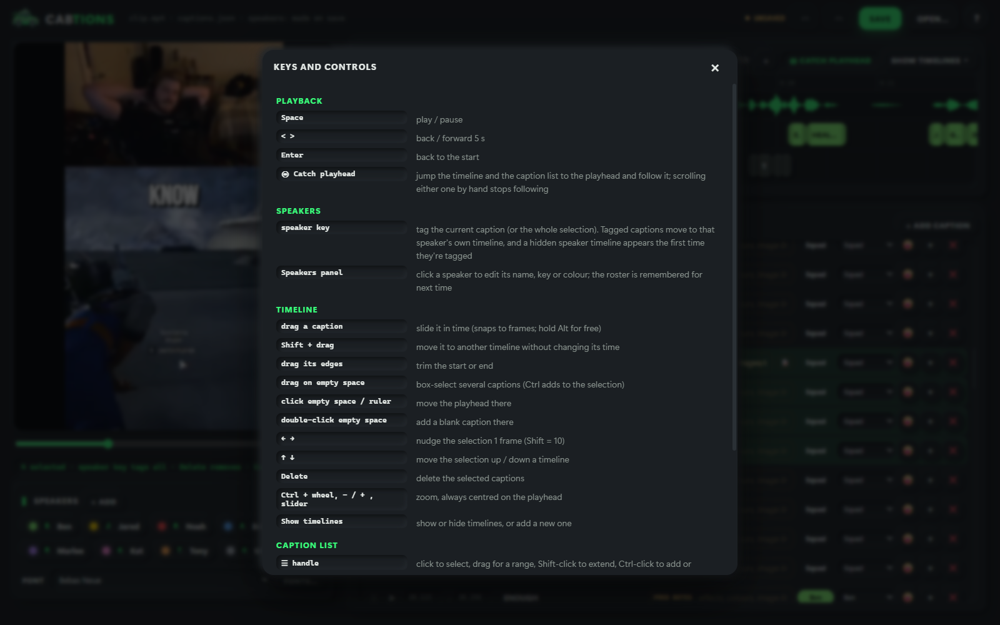

<p align="center"></p>

# Cabtions

A local caption editor for short-form video. Watch the clip and fix every caption while it plays: who
said it, the words, the timing and the emoji, plus notes for the renderer. Each speaker gets their own
timeline, and the audio waveform runs underneath so you can line words up with the spikes. Nothing to
install: Python's standard library runs a tiny local server, and everything else happens in the browser.

**Companion repo:** [video-editor](https://github.com/benjaminwellssss/video-editor)
([Gitea mirror](https://git.onebynine.ai/ben/video-editor)) is the pipeline on both sides of this editor.
It builds the `captions.json` you load here, and renders what you save (`scripts/render_captions.py` +
`scripts/caption_fx.py`). Its [workflow chart](https://github.com/benjaminwellssss/video-editor#readme)
shows where Cabtions fits in the whole stream → shorts process.





<sub>Also as a PNG: [`docs/workflow.png`](docs/workflow.png). Regenerate with `python docs/make_workflow.py`.</sub>

## Start it

1. **First time only:** run `install_shortcut.ps1` (right-click → Run with PowerShell). It puts a
   **Cabtions** shortcut with the cab icon on the desktop. Run it again if you move the repo.
2. **Double-click Cabtions.** The server starts in the system tray and the editor opens straight away in
   its own app window: no tabs, address bar or toolbar. It uses Chrome or Edge in app mode, and falls back
   to your default browser if neither is installed.
3. **Right-click the tray cab** for *Open Cabtions* (app window), *Open in browser*, *Restart server* or
   *Quit*.

Without the shortcut: `python server.py`, then open http://127.0.0.1:8765 in **Chrome or Edge**. Opening
files needs their File System Access API.



## The usual pass

1. **Get a clip folder.** The video-editor pipeline writes one per short in the deliverables folder,
   `CLIPS/<MM-DD-YYYY_GAME>/<clip>/`, with `<clip>.mp4` and `captions.json` (one word per card).
2. **Open** the video, its `captions.json` and, optionally, a speakers file. Set **Start in** once to your
   clips folder and every file dialog opens there (browsers can't take a typed path, so you pick it once;  it's remembered). If you skip the speakers file, Cabtions uses the roster you had last time and makes
   the file on first save.
3. **Fix whatever needs it**, in any order (how-tos below).
4. **Save.** It writes straight back to the files you opened.
5. **Render.** Ask Claude (in the video-editor repo) to render the captions. Saved cards are drawn
   **exactly as written**: notes become effects, image links are downloaded, and the result is composited
   into `<clip>_captioned.mp4` next to the clip.
6. **Proof** the captioned video. If anything is off, reopen, fix, save and ask for a re-render.

## How-tos

Every key and mouse action is also listed in the editor: click **?** in the top-right corner.



### Tag who's talking (and their timelines)
Press a **speaker key** to tag the current caption, or a whole selection at once. Defaults: B Ben,
J Jared, N Noah, A Brien, M Marlee, K Kat, T Tony, H Mitch.

**Every speaker has their own timeline.** Timeline 1 is always the first speaker in the roster (Ben) and
Timeline 2 the second (Jared); anyone else who's tagged follows. Speakers who haven't been tagged yet are
*hidden*. Tag Jared
for the first time and his timeline appears, and everything you tag as his moves onto it. When you open
a fresh caption file that already has speakers, each one is put on their own timeline in roster order,
so the first speaker in the roster (the streamer) is the top, big-caption timeline.

Edit a speaker's name, key or colour by clicking them in the Speakers panel. The roster is remembered for
next time (it's saved as you change it, and again when you close the editor).

If captions end up on the wrong timeline, **⇅ Autosort** moves every tagged caption onto its speaker's
timeline in one step.

### Show, hide or add timelines
**Show timelines ▾** lists every timeline with a ✓ and how many captions it holds, then the hidden
speakers. Click a hidden speaker to show their timeline, or an empty one to hide it. **Add new timeline**
at the bottom makes a free one with any name.

How it renders: the highest timeline showing a caption at that moment draws big on the seam, and any
others showing at the same time stack smaller underneath. A caption on its own always draws full size,
whichever timeline it's on. The live preview matches.

### Move and select captions on the timeline
- **Drag a caption** to slide it in time (snaps to frames; hold **Alt** for free movement). Drag its
  **edges** to trim.
- **Shift + drag** moves it to another timeline **without changing its time**.
- **Drag on empty space** to box-select several captions (**Ctrl** adds to the selection), then drag any
  of them to move them all.
- **Click empty space or the ruler** to move the playhead there. **Double-click empty space** to add a
  blank caption right there.
- **← / →** nudges the selection 1 frame (**Shift** = 10), **↑ / ↓** moves it a timeline up or down, and
  **Delete** deletes it.

### Trim dead air out of the video
Drag across the **Audio** row to select a stretch, then press **✂ Trim** (or **Delete**). Trimmed
stretches show hatched red; the preview skips them while playing, and **↺** on one brings it back.
Captions keep their original times. The trims are saved in the speakers file, and the video-editor
pipeline cuts them out of the finished video after the captions are composited
(`scripts/apply_trims.py`), so picture, sound and captions stay in sync.

### Line words up with the audio
The **Audio** row under the ruler is the clip's own waveform, on the same time scale as the captions.
Spikes show sibilance, plosives and laughs, so you can see where a word starts.

### Zoom and keep up with the playhead
Zoom with the **− / +** buttons, the slider, or **Ctrl + mouse wheel**. Zoom always centres on the red
playhead. **⦿ Catch playhead** jumps the timeline and the caption list to the playhead and follows it
while it plays; scrolling either one by hand stops following until you press it again. The caption list
scrolls inside its own panel, so following never moves the whole window.

### Fix a word, split a line, add an emoji
Click into the row's text box and type. `|` is a **line break**: `HECK|YES` puts YES under HECK. Use the
row's 😀 for emoji (or **Win + .**), **GIF** to search GIPHY and drop a GIF link straight into its PROD NOTES, **+** to add a caption after it, **✕** to delete it, or
**+ Add caption** to add one at the playhead on the active timeline (click a timeline's name to make it
active).

### Pick fonts (for the video, or per speaker)
The **Font** button opens a browser of every installed font, each previewed in its own typeface with your
own sample text. Click one to use it for the whole video; **★** pins it to the top of the list for next
time. Each speaker can also have their **own font**: click them in the Speakers panel and pick one, or
**Reset** to follow the video's font. The renderer knows Bebas Neue, Montserrat Black,
Anton, Archivo Black and Poppins ExtraBold by name. Any other font is saved with its file path so the
renderer can load it directly.

To list fonts from a folder that isn't installed, add it to `settings.json` next to `server.py`:
`{"font_dirs": ["<your-fonts-folder>"]}`.

### "Who's talking" overlay
The **Voice overlay** switch (on by default) adds a small avatar and name for each speaker in the video,
bottom-left of the facecam; whoever has a caption on screen lights up in their colour. The preview shows
it, and the renderer draws it.

### GIF search
**GIF** on a caption row searches GIPHY (it starts with the caption's own words) and clicking a result adds
its link to that caption's PROD NOTES. It needs a free GIPHY API key from developers.giphy.com, saved as
`"giphy_key"` in `settings.json` next to `server.py`. That file stays on your machine and is never
committed.

### Add an effect, a colour, or an image
Write it in plain English in the row's amber **PROD NOTES** field. Notes are **never shown** in the
video. The renderer understands:

| Write | Get |
|---|---|
| `grow`, `bigger`, `swell` | the caption scales up slowly across the card |
| `zoom`, `punch`, `pop`, `slam`, `big` | a fast punch-in |
| `shake`, `shaky`, `rumble` / `vibrate`, `jitter` | position jitter (shake is bigger and also rocks) |
| `dance`, `bounce`, `wiggle` | a smooth bob |
| `glow`, `shine`, `holy`, `neon` | a radiant flash behind the text |
| `echo`, `echoy` | the text sways with fading ghost copies |
| `multiplying`, `clone` | copies of the word fill the screen |
| `red`, `green`, `blue`, `yellow`, `orange`, `purple`, `pink`, `white`, `black`, `cyan` | overrides that card's text colour |
| `gentle` / `very` / `extremely` / `violent` / `max` | intensity: ×0.5 / ×1.3 / ×1.5 / ×2 / ×3 |
| `progressively more …` | ramps the effect across this and the following cards (or inside one card) |
| an image or GIF link | shows it for that card's duration, in the gameplay area just under the facecam: scaled to a fixed height (wider is fine) and centre-cropped if it's too wide. Captions always draw on top. Position words move it: `top left`, `dead center`, `bottom right`, …, or `above`/`below` the caption. `until the end` keeps it up to the end of the video. |
| the same link on a start caption and an end caption | shows it the whole way from the first to the second |
| `start … <link>` … a later card's `stop` | keeps the image up from the first card until the stop card |
| `start this image at "word"` | starts the image on an earlier card with that word |
| a Google Fonts link + `for all of "name" text` | that font (and the note's last colour) for every card of that speaker |
| `make all instances of "X" shake` / `every time X is said …` | applies to every card with that word |
| `near the bottom`, `under my face` … `centered again` | moves the caption text itself from this card onward |

A card with **no text but a note** is allowed: it drives an image or effect with nothing drawn on screen.
The renderer reports anything it can't understand as `NOT UNDERSTOOD` instead of silently dropping it.

## Controls

**Space** play/pause · **< / >** back / forward 5 s · **Enter** back to the start · **Backspace** undo ·
**Shift + Backspace** redo · **Delete** delete the selection · **Esc** clear the selection or close a
window. Undo and redo keep the last 10 steps.

## Files

`captions.json` is a list of cards:

```json
{ "start": 5.89, "end": 7.31, "lines": ["🍑 KING!!"], "lane": 1,
  "speaker": "Jared", "fill": [255, 214, 0, 255],
  "note": "gentle grow and vibrate of the text" }
```

- `lane` is the card's timeline (0-based, top first), omitted for the top one.
- `fill` (the speaker's colour) is rewritten from the speakers file on every save.
- `note` appears only on cards that have one. Unknown fields pass through untouched.
- Files from older versions with `*note*` typed into the caption text are converted on open.

The speakers file (`<captions>_speakers.json`) holds
`{"font", "font_file"?, "speakers": [{name, key, color, font?, font_file?}], "lanes": [{name, speaker}],
"voice_overlay", "trims"?: [[start, end], ...]}`. A plain speakers
array from an older version still opens.

`settings.json` next to `server.py` keeps the speaker roster, pinned fonts and your GIPHY key between
sessions. It's local to your machine and not tracked by git.

Only one Cabtions runs at a time: opening it again brings the existing window to the front.
